# Market Café Pre-Order — Pay with Your USF ID, Skip the Line

Pilot web app for **USF BENI-349** (Franco Ascheri & Alejandro).

**Problem:** at the USF Market Café, peak-hour lines (11:30am–12:45pm and 6:30–8pm) run 15–25 minutes, so students choose between eating and getting to class on time.

**Solution:** order and pay in one step from your phone (*Task Unification*), pick a pickup slot that matches when class ends, then grab your food from a numbered cubby: no line (*Subtraction*).

> **Pilot only:** sign-in and payment are **mock**. No real USF login and no real charges.

**Live app:** https://market-cafe-preorder.vercel.app (class demo page: https://market-cafe-preorder.vercel.app/#/demo)

## Pages

| Page | URL | Who |
|---|---|---|
| Student app | `/#/` | Maya / Diego on their phone |
| Staff view | `/#/staff` | Market Café staff behind the counter |
| Dashboard | `/#/staff/metrics` | Staff / manager: sales and operations analytics |
| Ready board | `/#/board` | TV next to the cubby shelf |
| Class demo | `/#/demo` | Projector: QR code for classmates to scan and order |

## How orders are shared

```
phones / staff tablet / TV  --(poll every 2 s)-->  /api/orders (Vercel Function)  -->  Upstash Redis (free)
```

- **Shared mode (deployed):** [`api/orders.ts`](api/orders.ts) stores orders in Upstash Redis. It assigns order numbers (#201, #202, …) and cubbies on the server, so two phones ordering at the same moment never get the same number or cubby. Every screen polls about every 2 seconds, so an order placed on a phone shows up on the staff view and ready board on other devices within a couple of seconds, and the student's status updates live. Polling pauses while a phone is in the background.
- **Fallback (local):** if `/api/orders` isn't reachable (plain `npm run dev`, or Redis not configured), the app automatically uses `localStorage`. Tabs of one browser stay in sync, other devices don't. The staff view footer shows which mode is active.
- Both modes implement the same interface, [`src/backend/types.ts`](src/backend/types.ts), so the backend can be swapped.

## Run it

Requires Node 20+.

```bash
npm install
npm run dev          # local mode: localStorage, one browser only
```

**Full mode locally** (shared `/api` + Redis), using the [Vercel CLI](https://vercel.com/docs/cli):

```bash
npm i -g vercel
vercel link          # pick the market-cafe-preorder project
vercel env pull      # downloads UPSTASH_REDIS_REST_URL / _TOKEN into .env.local (git-ignored)
vercel dev
```

### Environment variables

See [`.env.example`](.env.example). They are only needed by the server function in `/api` and are never sent to the browser:

| Name | Where |
|---|---|
| `UPSTASH_REDIS_REST_URL` | Vercel project (Production / Preview / Development), added by the Upstash Redis integration |
| `UPSTASH_REDIS_REST_TOKEN` | same |
| `VITE_BACKEND` (optional) | `local` or `api` forces the client's backend; the default auto-detects |

### Deploy

Vercel builds this as a Vite static site (`dist/`) plus Vercel Functions from `/api`, with no extra config. Pushing to `main` redeploys if the project is connected to GitHub; otherwise run `vercel --prod`.

Other commands:
- `npm run e2e` drives the full demo in headless Chrome (needs Google Chrome installed). The student phone, staff tablet and ready-board TV are separate browser contexts talking to the real `/api` handler, backed by an in-memory Redis stand-in. It checks every step and refreshes the screenshots below.
- `npm run build` makes a production build.
- `npm run scrape` refreshes the menu (see below).

## Class demo script (Monday)

1. **Before class:** open `/#/staff` and tap **Reset demo** so numbering starts at #201. Open `/#/board` on a second screen or tab and `/#/staff` on a laptop.
2. **Projector:** open `/#/demo`. Classmates scan the QR code with their phones.
3. **Students** (their own phones): sign in with any name and an 8-digit ID (mock), add food or **build a burrito or bowl**, tap **Checkout**, pick a pickup slot, and pay with **Dons Dollars** or **Flexi** (mock). Each gets an order number (e.g. **#204**) and a **cubby number**.
4. **Staff view:** orders appear within about 2 seconds, grouped by pickup slot. Tap **Start preparing**, then **Mark ready**. Each student's phone switches to **READY — grab it from cubby N**, and the number appears on the **ready board**.
5. Tap **Picked up** to free the cubby.
6. **Dashboard** (`/#/staff/metrics`): first show **Today**, which has only the orders placed in class. Then tap **Seed realistic demo day** and switch to **Last 7 days** for a full dashboard. Export **Orders CSV** / **Summary CSV** to open in Excel. Finish with **Clear sample orders**.
7. Tip: **Add sample order** on the staff view adds labelled sample orders if you need more on screen.

## Screenshots

| Sign in | Menu | Burrito / bowl builder | Checkout | Confirmation |
|---|---|---|---|---|
| 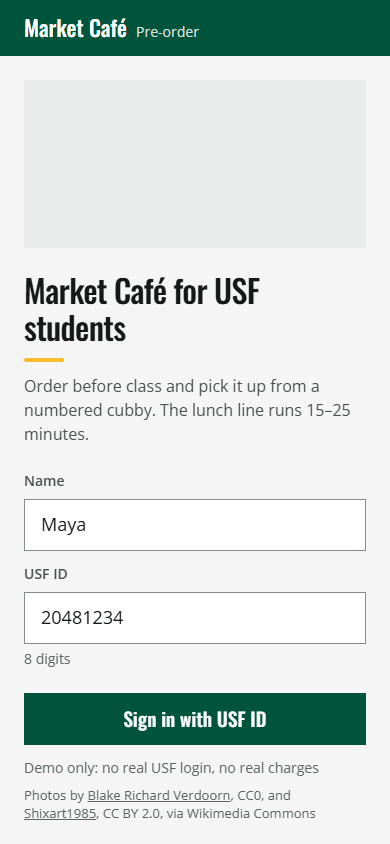 | 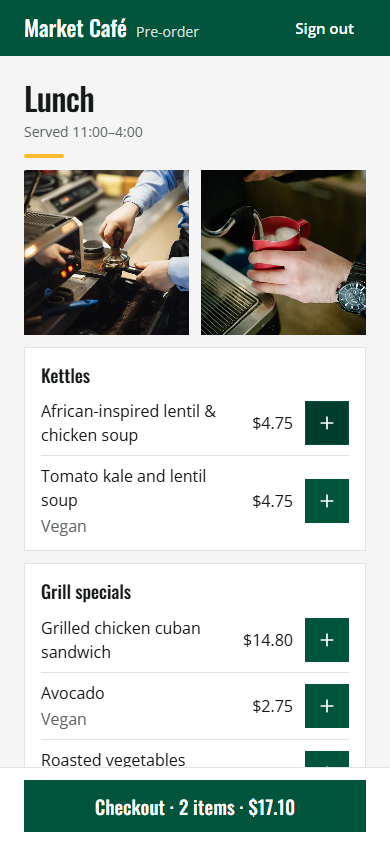 | 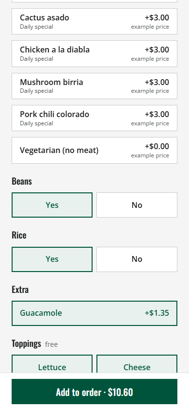 | 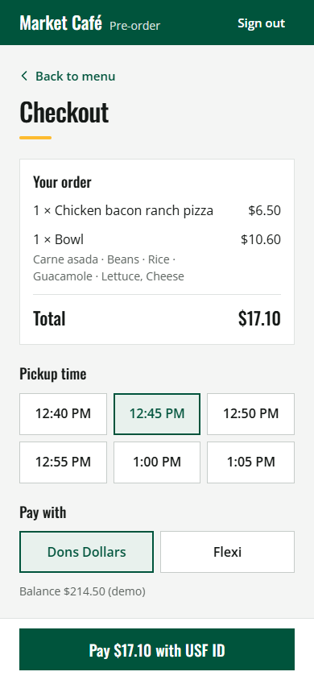 | 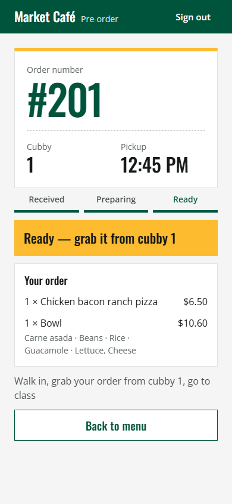 |

| Staff view | Ready board |
|---|---|
| 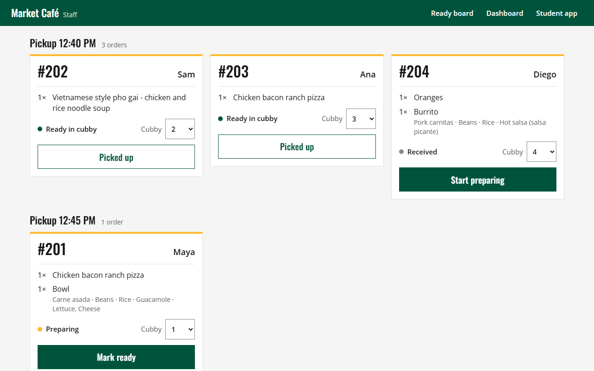 | 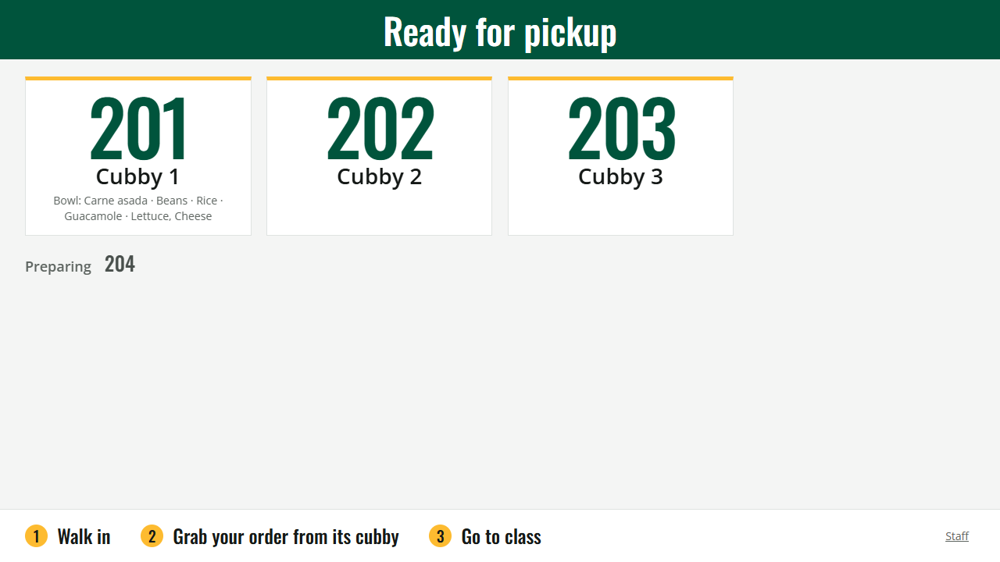 |

| Dashboard (class orders only) | Class demo QR |
|---|---|
| 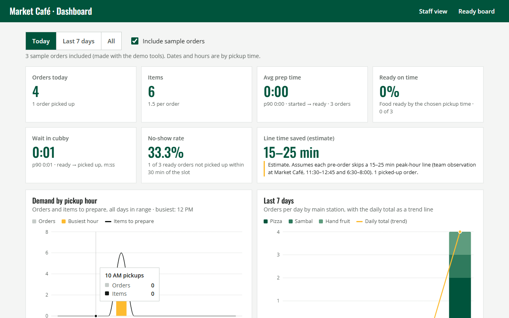 | 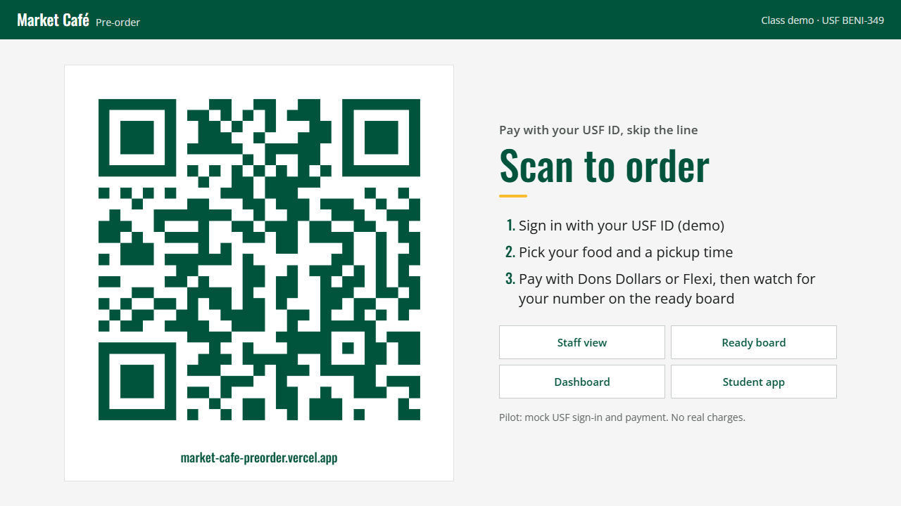 |

| Dashboard (seeded, last 7 days) | Top items by station (expanded) |
|---|---|
| 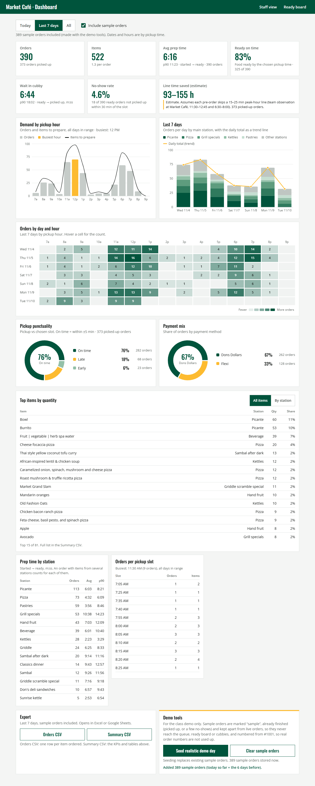 | 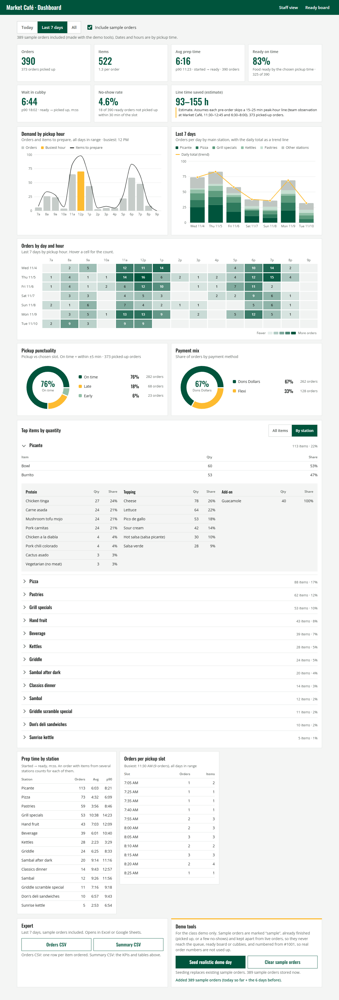 |

## Staff dashboard

`/#/staff/metrics` computes everything from the stored orders. There are no hardcoded numbers.

- **Filters:** date range (Today / Last 7 days / All) and **Include sample orders** (orders created by the demo tools are flagged `sample`).
- **Operational, not financial:** it counts orders and items and shows no $ figures.
- **KPIs:** orders, items, average and p90 prep time (started → ready), ready on time (food ready by the chosen pickup time), wait in cubby (ready → picked up, average and p90), no-show rate (ready orders not picked up within 30 min of the slot), and **line time saved**. The last one is labelled an *estimate*: picked-up orders × the 15–25 min peak line the team observed.
- **Charts** (Recharts, with hover tooltips and legends): demand by pickup hour (order bars with the busiest hour in gold, plus an items-to-prepare line). **Last 7 days**: orders per day stacked by main station, with a gold daily-total trend line. A **day × hour heatmap** of orders. **Donuts** for pickup punctuality and payment mix.
- **Top items by quantity:** one ranking of everything, with Burrito and Bowl listed like any other item. **By station** switches it to a collapsible section per station. The build-your-own station (picante) also shows protein, topping and add-on (guacamole) counts.
- **Orders per pickup slot**, with order and item counts.
- **Pickup punctuality:** when students picked up compared with their slot: early, on time (within ±5 min) or late. **Payment mix:** Dons Dollars vs Flexi as a share of orders, with no amounts.
- **Prep time by station:** average and p90. An order with items from several stations counts toward each of them (an approximation).
- Seeded demo days include realistic early and late pickups and about 4% no-shows. No-show orders stay with the other sample orders and never reach the live queue or board.
- **Export:** **Orders CSV** (one row per item ordered, quantities only) and **Summary CSV** (KPIs, the full ranking, per-station tables with the build breakdown, hours, days and slots, all as quantities). Examples: [`docs/exports/`](docs/exports/).
- **Demo tools:**
  - **Seed realistic demo day** creates sample orders for today and the 6 days before, using real menu items, prices and builder options. Seeding replaces any existing sample orders.
  - Seeded orders are already picked up, numbered from #1001, and kept in a separate Redis hash, so they never appear on the staff queue or ready board, take a cubby, or use up real order numbers.
  - **Clear sample orders** removes only sample orders.

### API (`api/orders.ts`)

| Request | What it does |
|---|---|
| `GET /api/orders?since=<version>` | Live orders only (not picked up, or created in the last 12 h), used by the phones, staff view and board every 2 s. Returns `unchanged` if nothing changed. |
| `GET /api/orders?scope=all&since=<version>` | Full history including samples (dashboard only) |
| `POST /api/orders` | New order: server assigns the next # and a free cubby |
| `POST /api/orders?bulk=1` | Store seeded sample orders |
| `PATCH /api/orders?id=<id>` | Change status / cubby (status changes are time-stamped) |
| `DELETE /api/orders` | Reset demo (all orders, numbering back to #201) |
| `DELETE /api/orders?sample=1` | Remove sample orders only |

## Menu data (real, scraped)

- **Source:** Bon Appétit's public USF menu for The Market Café, `https://usf.cafebonappetit.com/cafe/the-market-cafe/<date>/`
- **Saved to:** [`src/data/menu.json`](src/data/menu.json). It includes `source.url`, `source.menuDate`, `source.scannedDates` and `source.scrapedAt`.
- **Scraper:** [`scripts/scrape-menu.mjs`](scripts/scrape-menu.mjs). It reads the menu JSON that each page embeds (`Bamco.menu_items`, `Bamco.dayparts`). Run `npm run scrape` for today or `npm run scrape -- 2026-11-12` for a specific date. The daily menu comes from that date. Pizza types and burrito/bowl proteins are collected from the 7 days before and 4 days after it.
- **Current data:** daily menu from 2026-11-09. Dates scanned: 2026-11-02 to 2026-11-13.

### What is real and what is not

| Part | Source | Price |
|---|---|---|
| Item names, stations, meal periods (Breakfast 7:00–10:30, Lunch 11:00–4:00, Dinner 4:30–9:00), dietary tags | Site | — |
| Items with a price on the site | Site | **listed** |
| Pastries, hand fruit, spa water, buttermilk pancakes, Don's sandbox salad | Site (no price) | **example price** |
| **Pizza:** the 8 pizza types from the scanned dates, all **$6.50** | Site | **listed** |
| **Burrito / bowl base:** **$6.25**, from the site's "burrito bowl" item. The same base is used for a burrito. | Site | **listed** |
| **Everyday proteins:** Carne asada, Chicken tinga, Mushroom tofu mojo, Pork carnitas, each **+$3.00** | Site | **listed** |
| **Daily-special proteins** seen on the scanned dates (Beef birria, Chicken a la diabla and Mushroom birria from 2026-11-02 to 11-06; Cactus asado and Pork chili colorado from 2026-11-09 to 11-13), +$3.00 | Site (no price) | **example price** |
| Vegetarian (no meat) option, +$0.00 | Team | **example price** |
| Guacamole **+$1.35** | Team | team-provided |
| Beans yes/no, rice yes/no, free toppings: lettuce, cheese, sour cream, hot salsa (salsa picante), pico de gallo, salsa verde | Team | free |

Items whose price is marked `"priceSource": "example"` are labelled **"example price"** in the app. Individual toppings/ingredients and unpriced sides/garnishes are left off the item list. The daily menu changes, so re-run the scraper before a demo.

## Tech

Vite + React + TypeScript. Vercel Functions (`/api`) use `@upstash/redis`, and `qrcode` draws the demo QR code. Orders go through `src/store.ts` to a backend in `src/backend/`: `api.ts` (shared, polling) or `local.ts` (localStorage). Routes are hash-based: `#/`, `#/staff`, `#/staff/metrics` (dashboard), `#/board`, `#/demo`. Dashboard code lives in `src/dashboard/` (analytics, Recharts charts, CSV export, demo-day seeding).

```
scripts/scrape-menu.mjs   menu scraper
src/data/menu.json        scraped menu
api/orders.ts             Vercel Function: orders in Upstash Redis
src/store.ts              orders + mock sign-in
src/backend/              api (shared, polling) and local (localStorage) backends
src/demo/                 class-demo QR page
src/menu.ts               daypart + pickup-slot helpers
src/student/              student flow
src/staff/                staff view
src/board/                ready board
```

### Pilot limitations

- Live updates use polling about every 2 seconds, not websockets. That's plenty for a class demo and fits the free Upstash tier, though each open screen makes one small request every 2 seconds.
- The `/api` has no login: anyone with the URL can place or change orders. That's fine for a mock demo; a real pilot needs staff authentication.
- Mock sign-in and payment. A real version would integrate USF SSO and the campus card system (Dons Dollars / Flexi).
- Pickup slots are the next six 5-minute slots, at least 15 minutes from now and inside the current meal period's hours. After dinner closes, orders are for tomorrow's lunch.
- The mock sign-in is per device (stored in that browser). To simulate several students on one computer, use different browsers or a private window, or use **Add sample order** on the staff view.
- There are 24 cubbies. If all 24 are taken by open orders, new orders reuse cubby 1. Staff can't pick a cubby that another open order is using.
